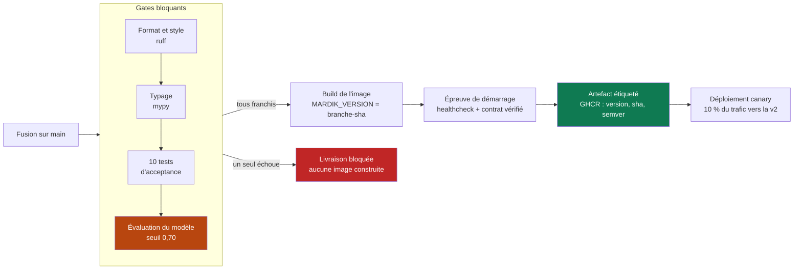
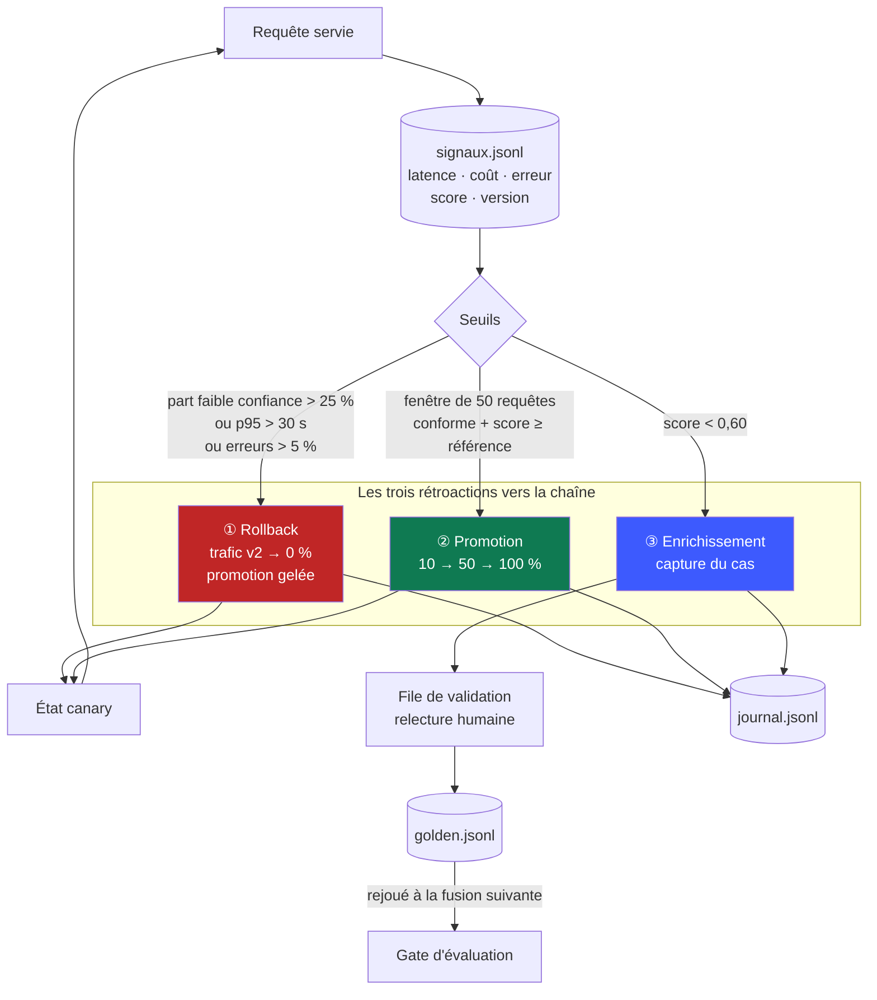

# Dossier de conception — Mardik v2

> Livrable de conception du brief « Plus jamais ça ». Ce document précède le code et
> justifie l'architecture ; il se lit avant le dépôt.

---

## 1. Synthèse du besoin

**Le problème.** Les juristes du client principal analysent des contrats commerciaux avec
un outil qui souffre de deux défauts connus. La v1 **tronque silencieusement** les
documents à 8 000 caractères : sur un contrat de 60 000 caractères elle en ignore 87 %
tout en présentant son résultat comme complet. Et elle **ne donne aucun indice de
fiabilité**, si bien que rien ne distingue une analyse solide d'une analyse hasardeuse.

**La contrainte qui structure tout.** Un déploiement manuel raté a mis la production à
terre une demi-journée. L'exigence n'est donc pas seulement « livrer la v2 » mais
« livrer la v2 **sans jamais casser la v1** et **sans jamais livrer à la main** ». C'est
cette contrainte de non-régression qui impose un déploiement progressif plutôt qu'un
remplacement, et une chaîne automatisée plutôt qu'une procédure documentée.

**Fonctionnel attendu.** Extraire cinq clauses structurantes (`duree`, `resiliation`,
`paiement`, `responsabilite`, `confidentialite`) sur l'intégralité du document, et
accompagner chaque analyse d'un indice de fiabilité exploitable par un non-technicien.

**Contraintes chiffrées.** Document ≤ 150 000 caractères, latence p95 ≤ 20 s, coût
≤ 0,05 €/analyse, seuil de fiabilité à 0,60, gate d'évaluation à 0,70, couverture ≥ 95 %.

> ⚠️ Le brief renvoie à un `besoin_client.md` qui **n'a pas été livré avec le sujet**. Ces
> valeurs sont des hypothèses assumées, figées dans [`besoin_client.md`](../besoin_client.md)
> et centralisées dans `src/mardik/config.py`. Elles sont modifiables en un seul endroit.

**Hors périmètre.** Modification du contrat `/v1` (figé) ; signature électronique ;
stockage durable des contrats ; gestion des droits ; ré-entraînement d'un modèle — on
opère un modèle de langage par API, on ne l'entraîne pas.

**Ambiguïtés du brief et arbitrages retenus.**

| Point | Arbitrage |
|---|---|
| « Au moins deux boucles » vs « les trois boucles » | Les **trois** sont implémentées : les livrables priment. |
| Canary = deux releases, ou migration v1→v2 ? | **Les deux à la fois** : ici la version du modèle *est* la version du service. |
| `M1` / `M3` | Non définis dans le sujet ni dans aucun document fourni. Signalé, sans impact. |
| Dérive « par rapport à quoi » ? | Par rapport à la distribution mesurée **au moment où la version a passé le gate** (`eval/reference_gate.json`), et non à une moyenne glissante mouvante. |

---

## 2. Contrat d'API v2

### Principe structurant : sur-ensemble strict

`ReponseV2` **hérite** de `ReponseV1`. Un client écrit pour la v1 lit `clauses` ; routé
vers la v2 par le canary, il reçoit ce même champ plus les nouveaux, qu'il ignore.

**La compatibilité ascendante tient à la forme du contrat, pas à un aiguillage de
faveur.** C'est vérifié par un test qui compare les jeux de champs des deux schémas, et
par `scripts/client_v1.py` qui ne doit jamais être modifié.

### Points d'entrée

| Méthode | Chemin | Rôle |
|---|---|---|
| `POST` | `/analyser` | Réparti par le canary — **ce que consomment les clients** |
| `POST` | `/v1/analyser` | Force la v1 |
| `POST` | `/v2/analyser` | Force la v2 (jeu d'évaluation, tests) |
| `GET` | `/sante` | Sonde de vivacité + version livrée + état canary |
| `GET` | `/api/signaux` | Les cinq signaux du tableau de bord |
| `GET` | `/api/journal` | Journal de pilotage |
| `POST` | `/api/canary/rollback` | Bouton de rollback |

### Entrée

```json
{ "contrat": "CONTRAT DE PRESTATION…", "reference": "dossier-4412" }
```

### Sortie v2

```json
{
  "clauses": { "duree": "…prend effet le 1er janvier 2026…", "paiement": "…30 jours…" },
  "version_modele": "v2",
  "version_livree": "main-a1b2c3d",
  "reference": "dossier-4412",

  "score_confiance": 0.87,
  "fiable": true,
  "couverture": 1.0,
  "completude": 0.8,
  "clauses_manquantes": ["confidentialite"],
  "segments_analyses": 6,
  "segments_total": 6
}
```

Les quatre premiers champs constituent la réponse v1 ; les suivants sont les ajouts v2.

### Le score de confiance

```
score = 0,40 × couverture  +  0,35 × complétude  +  0,25 × auto-évaluation
```

- **couverture** — part du document réellement analysée (un segment perdu la fait chuter)
- **complétude** — part des cinq clauses attendues effectivement trouvées
- **auto-évaluation** — certitude déclarée par le modèle, moyennée sur les segments

**75 % du score est déterministe.** Ce choix est délibéré et répond à deux besoins :
il rend le score **explicable à un juriste** (« 100 % du contrat lu, 4 clauses sur 5
trouvées ») plutôt qu'opaque, et il le rend **reproductible en test** — condition sans
laquelle la démonstration de dérive relèverait du tirage au sort. Une note purement
auto-déclarée par un modèle de langage est connue pour être mal calibrée.

### Codes d'erreur

| HTTP | Code | Cause |
|---|---|---|
| 400 | `CONTRAT_VIDE` | Champ `contrat` vide ou blanc |
| 413 | `CONTRAT_TROP_LONG` | Au-delà de 150 000 caractères |
| 422 | — | Champ absent ou mal typé (validation de schéma) |
| 503 | `MOTEUR_INDISPONIBLE` | Le modèle n'a pas répondu — alimente le taux d'erreur |

Toute erreur renvoie `{code, message, detail}` : un code stable et un message lisible,
jamais une trace d'exception.

### Versionnage

`MARDIK_VERSION` est injecté **au build** sous la forme `<branche>-<sha7>`. Cet
identifiant apparaît dans chaque réponse d'API, chaque signal et chaque entrée du journal.
C'est ce qui rend vérifiable l'exigence « on peut identifier quelle version sert quel
trafic ».

---

## 3. Schéma de la chaîne LLMOps



**Ce qui rend le blocage réel.** Le job `artefact` déclare `needs: gates`. GitHub Actions
refuse de le démarrer si `gates` échoue : l'image n'est donc **jamais construite**, encore
moins publiée. Il n'existe aucun chemin permettant de livrer sans avoir franchi les gates
— ce n'est pas une convention d'équipe, c'est une impossibilité technique.

**Le gate d'évaluation** rejoue l'intégralité du jeu d'évaluation, cas capturés en
production inclus, et sort en **code 1** sous le seuil. Il tourne sur le moteur factice :
les gates doivent être gratuits, déterministes et exécutables sans aucun secret.

---

## 4. Schéma de la boucle d'observabilité



**La boucle ③ passe par une validation humaine, délibérément.** Un score bas signifie que
le modèle **doute**, pas qu'il **s'est trompé**. Verser automatiquement sa sortie comme
vérité de référence graverait une erreur dans le jeu qui garde la chaîne — le jeu
d'évaluation perdrait précisément la propriété qui le rend utile. Un juriste relit le cas
depuis le tableau de bord avant intégration.

**Après un rollback, la promotion est gelée** (`gele: true`). En production on arrête
l'hémorragie d'abord, on diagnostique ensuite ; une remontée automatique juste après un
retour arrière produirait une oscillation.

---

## 5. Tableau de pilotage

| Signal | Seuil | Rétroaction déclenchée | Trace |
|---|---|---|---|
| Part d'analyses peu fiables (v2, fenêtre 20) | > 25 % | **Rollback** → trafic v2 à 0 %, promotion gelée | `journal.jsonl` : `rollback`, signal `part_faible_confiance`, auteur `automatique` |
| Latence p95 (v2, fenêtre 20) | > 30 s | **Rollback** | `journal.jsonl` : signal `latence_p95` |
| Taux d'erreur (v2, fenêtre 20) | > 5 % | **Rollback** | `journal.jsonl` : signal `taux_erreur` |
| Score moyen v2 (fenêtre 50) | ≥ référence du gate | **Promotion** au palier suivant | `journal.jsonl` : `promotion`, valeur observée vs référence |
| Score moyen v2 (fenêtre 50) | < référence du gate | **Promotion refusée** | `journal.jsonl` : `promotion_refusee` |
| Score de confiance d'une analyse | < 0,60 | **Capture** pour enrichissement | `journal.jsonl` : `capture_faible_confiance` + `cas_id` |
| Validation humaine d'un cas capturé | — | **Versement** au jeu d'évaluation | `journal.jsonl` : `enrichissement_jeu_evaluation`, auteur nominatif |
| Note d'évaluation au gate | < 0,70 | **Livraison bloquée** (code 1) | `eval/historique.jsonl` + rapport en artefact CI |
| Décision humaine (bouton) | — | **Rollback** ou changement de répartition | `journal.jsonl` : signal `decision_humaine`, auteur nominatif |

**Aucune bascule de trafic n'échappe à cette table.** Toute modification de la répartition
passe obligatoirement par `canary.definir_poids()`, qui écrit au journal avant de rendre
la main. Chaque entrée porte le signal déclencheur, la valeur observée, le seuil franchi,
l'auteur (`automatique` ou l'identité de la personne) et la version livrée — c'est la
réponse complète au « quel signal, quand, par qui ou par quoi » du CTO.

---

## 6. Vérification

Les dix critères de performance du brief sont transcrits en tests exécutables dans
`tests/test_acceptance_chaine.py` et `tests/test_acceptance_observabilite.py`. Ce sont eux
qui définissent « fini ».

Démonstration en direct effectuée : avec le canary à 100 %, `traffic_sim.py --profil
degrade` a fait chuter le score à 0,538, la part d'analyses peu fiables a atteint 0,9
contre un seuil de 0,25, et **le rollback s'est déclenché seul** à la vingtième requête —
trafic ramené à 0 %, promotion gelée, événement tracé. Les requêtes suivantes ont été
servies par la v1, sans interruption de service.

Le profil dégradé ne truque aucun score : il modifie la **distribution des documents
entrants** (longs mais vides de vocabulaire juridique, comme des scans mal reconnus). La
dérive est réelle ; c'est l'observabilité qui la détecte.
