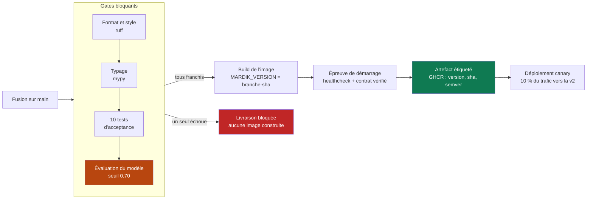
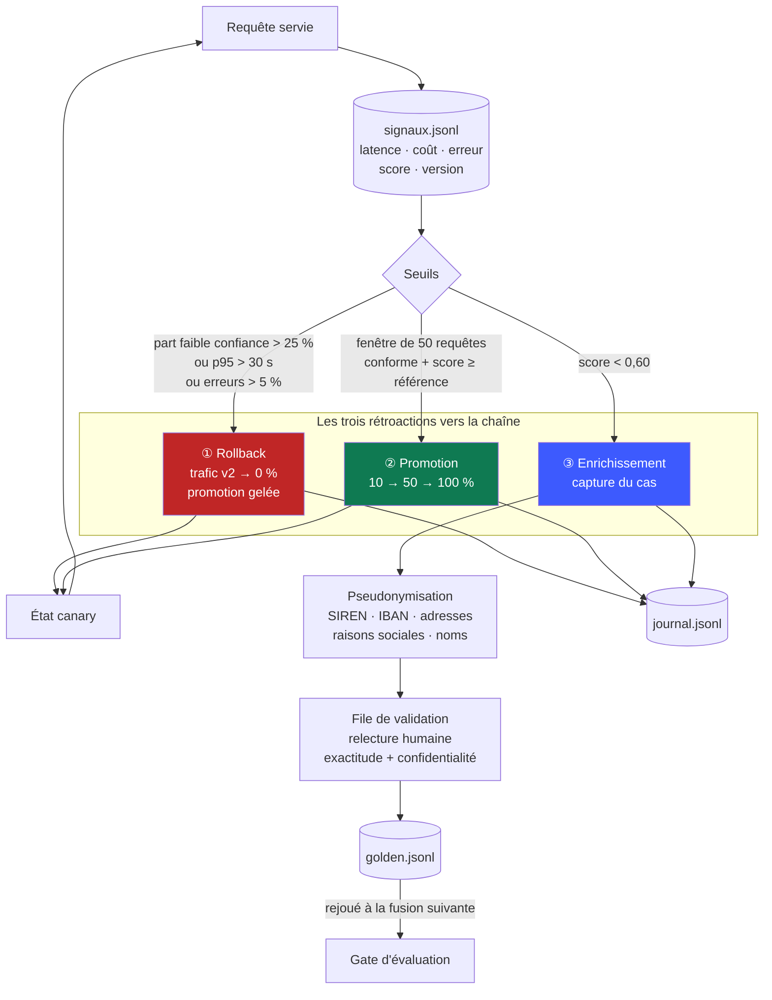

# Dossier de conception — Mardik v2

> Livrable de conception du brief « Plus jamais ça ». Ce document précède le code et
> justifie l'architecture ; il se lit avant le dépôt.

---

## 1. Synthèse du besoin

**Le problème.** Les juristes du client principal analysent des contrats commerciaux avec
un outil qui souffre de deux défauts connus. La v1 **tronque silencieusement** les
documents à 8 000 caractères : sur un contrat de 60 000 caractères elle en ignore 87 %
tout en présentant son résultat comme complet. Et elle **ne donne aucun indice de
fiabilité**, si bien que rien ne distingue une analyse solide d'une analyse hasardeuse.

**La contrainte qui structure tout.** Un déploiement manuel raté a mis la production à
terre une demi-journée. L'exigence n'est donc pas seulement « livrer la v2 » mais
« livrer la v2 **sans jamais casser la v1** et **sans jamais livrer à la main** ». C'est
cette contrainte de non-régression qui impose un déploiement progressif plutôt qu'un
remplacement, et une chaîne automatisée plutôt qu'une procédure documentée.

**Fonctionnel attendu.** Extraire cinq clauses structurantes (`duree`, `resiliation`,
`paiement`, `responsabilite`, `confidentialite`) sur l'intégralité du document, et
accompagner chaque analyse d'un indice de fiabilité exploitable par un non-technicien.

**Contraintes chiffrées.** Document ≤ 150 000 caractères, latence p95 ≤ 20 s, coût
≤ 0,05 €/analyse, seuil de fiabilité à 0,60, gate d'évaluation à 0,70, couverture ≥ 95 %.

> ⚠️ Le brief renvoie à un `besoin_client.md` qui **n'a pas été livré avec le sujet**. Ces
> valeurs sont des hypothèses assumées, figées dans [`besoin_client.md`](../besoin_client.md)
> et centralisées dans `src/mardik/config.py`. Elles sont modifiables en un seul endroit.

**Hors périmètre.** Modification du contrat `/v1` (figé) ; signature électronique ;
stockage durable des contrats ; gestion des droits ; ré-entraînement d'un modèle — on
opère un modèle de langage par API, on ne l'entraîne pas.

**Ambiguïtés du brief et arbitrages retenus.**

| Point | Arbitrage |
|---|---|
| « Au moins deux boucles » vs « les trois boucles » | Les **trois** sont implémentées : les livrables priment. |
| Canary = deux releases, ou migration v1→v2 ? | **Les deux à la fois** : ici la version du modèle *est* la version du service. |
| `M1` / `M3` | Non définis dans le sujet ni dans aucun document fourni. Signalé, sans impact. |
| Dérive « par rapport à quoi » ? | Par rapport à la distribution mesurée **au moment où la version a passé le gate** (`eval/reference_gate.json`), et non à une moyenne glissante mouvante. |

---

## 2. Choix d'outils non triviaux

Les outils déjà familiers de l'équipe ne sont pas justifiés ici : `pytest`, `ruff`,
`mypy`, `uv`, Docker, GitHub Actions, OpenTelemetry/Jaeger et `structlog` sont repris de
nos projets précédents et ne posent pas de question de conception. Restent cinq décisions
qui méritent une justification, chacune avec l'alternative écartée et sa limite connue.

### 2.1 — Une passerelle canary applicative, et non un proxy ou Kubernetes

**Écarté :** répartition pondérée par Nginx/Traefik, ou Argo Rollouts sur Kubernetes.

**Retenu :** un service FastAPI qui lit un poids en configuration et route chaque requête.

Trois raisons décident :

1. **La part de trafic v1/v2 est un des cinq signaux imposés.** Mesurée dans
   l'application, elle est exacte et immédiate ; derrière un proxy, il faudrait analyser
   des journaux d'accès pour la reconstituer.
2. **Le rollback devient une écriture d'état, donc un bouton.** C'était la demande
   explicite du brief (« le plus facile possible, genre un bouton »). Avec Argo Rollouts,
   un retour arrière suppose un cluster, un contrôleur et une réconciliation.
3. **Aucune bascule ne peut échapper à la trace.** Tout passe par
   `canary.definir_poids()`, qui écrit au journal avant de rendre la main. Avec un proxy,
   un `reload` de configuration à la main contournerait le journal — exactement le
   « déploiement artisanal » que le brief interdit.

**Limite assumée :** cette passerelle est un point de passage unique. À l'échelle, la
répartition devrait remonter au niveau infrastructure, avec le journal alimenté par le
contrôleur de déploiement plutôt que par l'application.

### 2.2 — Un moteur de langage factice déterministe comme composant de production

**Écarté :** appeler le vrai modèle en intégration continue, ou le remplacer par un mock
de bibliothèque écrit dans les tests.

**Retenu :** `MARDIK_FAKE_LLM=1`, un moteur qui repère le vocabulaire juridique de façon
déterministe, activé par variable d'environnement.

Les gates doivent être **gratuits, reproductibles et exécutables sans aucun secret** —
sinon ils finissent désactivés sur les branches, et un gate qu'on désactive n'est plus un
gate. Un mock de bibliothèque n'aurait pas suffi : le gate d'évaluation et
`traffic_sim.py` s'exécutent hors des tests, en dehors de toute portée de `unittest.mock`.

**Limite assumée :** les gates valident la chaîne et le contrat, pas la qualité
linguistique du vrai modèle. Celle-ci relève d'un workflow séparé, déclenché à la main
parce qu'il coûte de l'argent — la séparation que nous avions déjà retenue sur Velmo2.

### 2.3 — Des fichiers JSONL en append, et non une base de données

**Écarté :** PostgreSQL pour le journal, Prometheus pour les métriques.

**Retenu :** `signaux.jsonl`, `journal.jsonl`, `golden.jsonl` en écriture seule.

Le journal de pilotage est une **piste d'audit** : on y ajoute, on n'y modifie jamais.
Un fichier ouvert en `append` traduit cette propriété directement, se lit sans outil, se
joint à un rapport, et se rejoue à l'identique en test. Prometheus aurait apporté ses
propres agrégations mais aurait éclaté la vérité entre deux magasins : les métriques d'un
côté, les décisions de l'autre — alors que la question du brief est précisément de les
relier.

**Limite assumée :** aucune rotation ni rétention n'est implémentée, et les lectures sont
en O(n). Au-delà de quelques dizaines de milliers de requêtes, il faut une base de séries
temporelles pour les signaux — en gardant le journal de pilotage en JSONL, car son volume
reste faible et sa valeur probante tient à son immuabilité.

### 2.4 — Un score de confiance composite maison

**Écarté :** les *logprobs* du modèle, ou une notation par un second modèle
(*LLM-as-judge*).

**Retenu :** `0,40 × couverture + 0,35 × complétude + 0,25 × auto-évaluation`.

Les *logprobs* ne sont pas exposés par toutes les API et mesurent la confiance en la
*génération du texte*, pas en l'*exactitude de l'extraction*. Le *LLM-as-judge* double le
coût et la latence, et reste mal calibré. Le score composite est explicable à un juriste
et reproductible en test — voir §3 pour le détail.

### 2.5 — Une pseudonymisation par expressions régulières

**Écarté :** Microsoft Presidio ou un modèle de reconnaissance d'entités nommées spaCy.

**Retenu :** un jeu de motifs couvrant SIREN/SIRET, IBAN, courriels, téléphones,
adresses, montants, raisons sociales et civilités.

Presidio aurait mieux couvert les noms propres isolés, mais ajoute un modèle de plusieurs
centaines de mégaoctets à une image qui doit démarrer vite dans la chaîne, pour une
étape qui ne concerne qu'une poignée de documents par jour.

**Limite assumée, et c'est la plus importante du dossier :** une raison sociale écrite au
fil du texte sans forme juridique ni civilité passera au travers. C'est pourquoi la
relecture humaine **fait aussi office de contrôle de confidentialité** (§5) — le
dispositif ne repose pas sur la seule expression régulière.

---

## 3. Contrat d'API v2

### Principe structurant : sur-ensemble strict

`ReponseV2` **hérite** de `ReponseV1`. Un client écrit pour la v1 lit `clauses` ; routé
vers la v2 par le canary, il reçoit ce même champ plus les nouveaux, qu'il ignore.

**La compatibilité ascendante tient à la forme du contrat, pas à un aiguillage de
faveur.** C'est vérifié par un test qui compare les jeux de champs des deux schémas, et
par `scripts/client_v1.py` qui ne doit jamais être modifié.

### Points d'entrée

| Méthode | Chemin | Rôle |
|---|---|---|
| `POST` | `/analyser` | Réparti par le canary — **ce que consomment les clients** |
| `POST` | `/v1/analyser` | Force la v1 |
| `POST` | `/v2/analyser` | Force la v2 (jeu d'évaluation, tests) |
| `GET` | `/sante` | Sonde de vivacité + version livrée + état canary |
| `GET` | `/api/signaux` | Les cinq signaux du tableau de bord |
| `GET` | `/api/journal` | Journal de pilotage |
| `POST` | `/api/canary/rollback` | Bouton de rollback |

### Entrée

```json
{ "contrat": "CONTRAT DE PRESTATION…", "reference": "dossier-4412" }
```

### Sortie v2

```json
{
  "clauses": { "duree": "…prend effet le 1er janvier 2026…", "paiement": "…30 jours…" },
  "version_modele": "v2",
  "version_livree": "main-a1b2c3d",
  "reference": "dossier-4412",

  "score_confiance": 0.87,
  "fiable": true,
  "couverture": 1.0,
  "completude": 0.8,
  "clauses_manquantes": ["confidentialite"],
  "segments_analyses": 6,
  "segments_total": 6
}
```

Les quatre premiers champs constituent la réponse v1 ; les suivants sont les ajouts v2.

### Le score de confiance

```
score = 0,40 × couverture  +  0,35 × complétude  +  0,25 × auto-évaluation
```

- **couverture** — part du document réellement analysée (un segment perdu la fait chuter)
- **complétude** — part des cinq clauses attendues effectivement trouvées
- **auto-évaluation** — certitude déclarée par le modèle, moyennée sur les segments

**75 % du score est déterministe.** Ce choix est délibéré et répond à deux besoins :
il rend le score **explicable à un juriste** (« 100 % du contrat lu, 4 clauses sur 5
trouvées ») plutôt qu'opaque, et il le rend **reproductible en test** — condition sans
laquelle la démonstration de dérive relèverait du tirage au sort. Une note purement
auto-déclarée par un modèle de langage est connue pour être mal calibrée.

### Codes d'erreur

| HTTP | Code | Cause |
|---|---|---|
| 400 | `CONTRAT_VIDE` | Champ `contrat` vide ou blanc |
| 413 | `CONTRAT_TROP_LONG` | Au-delà de 150 000 caractères |
| 422 | — | Champ absent ou mal typé (validation de schéma) |
| 503 | `MOTEUR_INDISPONIBLE` | Le modèle n'a pas répondu — alimente le taux d'erreur |

Toute erreur renvoie `{code, message, detail}` : un code stable et un message lisible,
jamais une trace d'exception.

### Versionnage : qu'est-ce qu'une version livrable ?

Le brief exige qu'une fusion produise « une version étiquetée **(code + modèle +
config)** ». L'étiquette de code seule ne suffirait pas : **changer de modèle ou déplacer
un seuil modifie le comportement sans changer le commit**, et deux déploiements qui ne se
comportent pas pareil ne peuvent pas porter la même identité.

L'identité servie comporte donc trois composantes et une empreinte qui les résume :

| Composante | Source | Exemple |
|---|---|---|
| `code` | `MARDIK_VERSION`, injecté au build (`<branche>-<sha7>`) | `main-a1b2c3d` |
| `modele` | moteur réellement actif | `Kimi-K2.6` ou `factice` |
| `config` | empreinte des seuils qui gouvernent une décision | `cfg-4388c5a6` |
| **`empreinte`** | condensé des trois | **`v-ef9501fa`** |

Vérification : à code et modèle constants, faire passer le seuil de fiabilité de 0,60 à
0,70 change `config` **et** `empreinte`. C'est verrouillé par un test.

**Où cette identité apparaît.** `GET /sante` en donne le détail ; chaque **signal** et
chaque **entrée du journal de pilotage** portent l'`empreinte`. C'est ce qui permet
d'attribuer un comportement observé à une identité précise — et non seulement à un
commit. La réponse d'API, elle, ne porte que `version_livree` : le contrat `/v1` reste
inchangé, conformément au périmètre.

### Où vivent les secrets

Aucun secret n'est stocké dans le dépôt. Ils vivent dans **GitHub Secrets** et sont
injectés en variables d'environnement à l'exécution ; en local, dans un `.env` exclu par
`.gitignore`, dont seul `.env.example` est versionné.

Point de conception qui en découle : **les quatre gates n'ont besoin d'aucun secret**,
puisqu'ils tournent sur le moteur factice. Seul le job de publication utilise le
`GITHUB_TOKEN` fourni automatiquement par GitHub Actions. C'est délibéré — un gate qui
exige un secret ne peut pas s'exécuter sur une contribution externe, finit par être
désactivé, et un gate qu'on désactive n'est plus un gate.

---

## 4. Schéma de la chaîne LLMOps



**Ce qui rend le blocage réel.** Le job `artefact` déclare `needs: gates`. GitHub Actions
refuse de le démarrer si `gates` échoue : l'image n'est donc **jamais construite**, encore
moins publiée. Il n'existe aucun chemin permettant de livrer sans avoir franchi les gates
— ce n'est pas une convention d'équipe, c'est une impossibilité technique.

**Le gate d'évaluation** rejoue l'intégralité du jeu d'évaluation, cas capturés en
production inclus, et sort en **code 1** sous le seuil. Il tourne sur le moteur factice :
les gates doivent être gratuits, déterministes et exécutables sans aucun secret.

---

## 5. Schéma de la boucle d'observabilité



**Pourquoi la distribution du score, et pas seulement sa moyenne.** Parce qu'une moyenne
décrit une population homogène et ment dès qu'elle ne l'est pas. Ces deux situations ont
la même moyenne de 0,75 :

```
   CAS A — population homogène          CAS B — deux populations
   ┌───────────────────────┐            ┌───────────────────────┐
   │            ███        │            │  ███             ███  │
   │         ███████       │            │  ███             ███  │
   │      ██████████       │            │  ███             ███  │
   └───────────────────────┘            └───────────────────────┘
    0,4    0,6    0,8   1,0              0,4    0,6    0,8   1,0
                                          ↑
                              la moitié du trafic est inexploitable
```

Dans le cas B, un client sur deux reçoit une analyse à revérifier et la moyenne ne le dit
pas. C'est exactement ce que produit un flux mixte — des contrats propres et des scans
mal reconnus. C'est d'ailleurs la raison pour laquelle la condition de rollback porte sur
la **part d'analyses sous le seuil** (> 25 %) et non sur le score moyen : la part est une
mesure de la queue de distribution, la moyenne l'écrase.

**La boucle ③ passe par une validation humaine, délibérément.** Un score bas signifie que
le modèle **doute**, pas qu'il **s'est trompé**. Verser automatiquement sa sortie comme
vérité de référence graverait une erreur dans le jeu qui garde la chaîne — le jeu
d'évaluation perdrait précisément la propriété qui le rend utile. Un juriste relit le cas
depuis le tableau de bord avant intégration.

**Et cette même étape protège les données du client.** Un cas capturé est versé dans
`eval/golden.jsonl`, fichier **commité dans Git et rejoué par l'intégration continue** :
sans traitement, des contrats clients réels partiraient dans un dépôt et chez un
hébergeur tiers. Le dispositif comporte donc deux niveaux :

1. **Pseudonymisation automatique à la capture** — le texte d'origine ne quitte jamais la
   mémoire du processus. Sont remplacés par des marqueurs : SIREN/SIRET, IBAN, courriels,
   téléphones, adresses postales, montants, raisons sociales et noms de personnes.
   L'unité (`euros`) et le vocabulaire juridique sont conservés, si bien que la détection
   des clauses est inchangée — c'est vérifié par un test.
2. **La relecture humaine comme dernier contrôle** — les expressions régulières ne
   rattrapent pas une raison sociale écrite au fil du texte (voir §2.5). Le tableau de
   bord affiche au relecteur le décompte de ce qui a été retiré, précisément pour qu'il
   juge de ce qui pourrait rester.

Le décompte des substitutions accompagne le cas jusque dans le jeu d'évaluation et dans
le journal de pilotage : on peut donc, a posteriori, vérifier ce qui a été anonymisé sur
n'importe quel cas versé.

**Après un rollback, la promotion est gelée** (`gele: true`). En production on arrête
l'hémorragie d'abord, on diagnostique ensuite ; une remontée automatique juste après un
retour arrière produirait une oscillation.

---

## 6. Tableau de pilotage

| Signal | Seuil | Rétroaction déclenchée | Trace |
|---|---|---|---|
| Part d'analyses peu fiables (v2, fenêtre 20) | > 25 % | **Rollback** → trafic v2 à 0 %, promotion gelée | `journal.jsonl` : `rollback`, signal `part_faible_confiance`, auteur `automatique` |
| Latence p95 (v2, fenêtre 20) | > 30 s | **Rollback** | `journal.jsonl` : signal `latence_p95` |
| Taux d'erreur (v2, fenêtre 20) | > 5 % | **Rollback** | `journal.jsonl` : signal `taux_erreur` |
| Score moyen v2 (fenêtre 50) | ≥ référence du gate | **Promotion** au palier suivant | `journal.jsonl` : `promotion`, valeur observée vs référence |
| Score moyen v2 (fenêtre 50) | < référence du gate | **Promotion refusée** | `journal.jsonl` : `promotion_refusee` |
| Score de confiance d'une analyse | < 0,60 | **Capture** pour enrichissement | `journal.jsonl` : `capture_faible_confiance` + `cas_id` |
| Validation humaine d'un cas capturé | — | **Versement** au jeu d'évaluation | `journal.jsonl` : `enrichissement_jeu_evaluation`, auteur nominatif |
| Note d'évaluation au gate | < 0,70 | **Livraison bloquée** (code 1) | `eval/historique.jsonl` + rapport en artefact CI |
| Décision humaine (bouton) | — | **Rollback** ou changement de répartition | `journal.jsonl` : signal `decision_humaine`, auteur nominatif |

**Aucune bascule de trafic n'échappe à cette table.** Toute modification de la répartition
passe obligatoirement par `canary.definir_poids()`, qui écrit au journal avant de rendre
la main. Chaque entrée porte le signal déclencheur, la valeur observée, le seuil franchi,
l'auteur (`automatique` ou l'identité de la personne) et la version livrée — c'est la
réponse complète au « quel signal, quand, par qui ou par quoi » du CTO.

---

## 7. Vérification

Les dix critères de performance du brief sont transcrits en tests exécutables dans
`tests/test_acceptance_chaine.py` et `tests/test_acceptance_observabilite.py`. Ce sont eux
qui définissent « fini ».

Démonstration en direct effectuée : avec le canary à 100 %, `traffic_sim.py --profil
degrade` a fait chuter le score à 0,538, la part d'analyses peu fiables a atteint 0,9
contre un seuil de 0,25, et **le rollback s'est déclenché seul** à la vingtième requête —
trafic ramené à 0 %, promotion gelée, événement tracé. Les requêtes suivantes ont été
servies par la v1, sans interruption de service.

Le profil dégradé ne truque aucun score : il modifie la **distribution des documents
entrants** (longs mais vides de vocabulaire juridique, comme des scans mal reconnus). La
dérive est réelle ; c'est l'observabilité qui la détecte.
